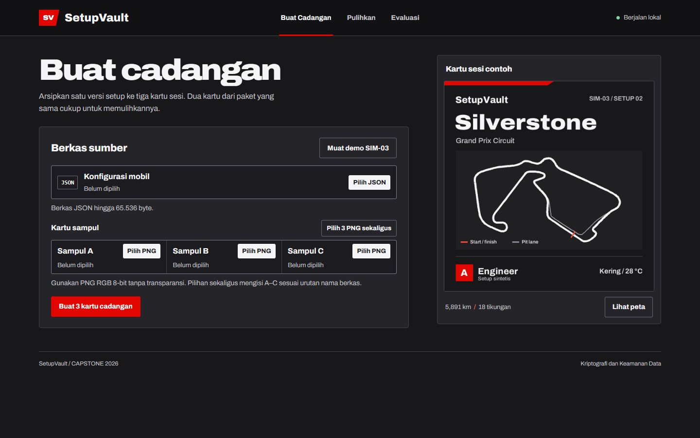
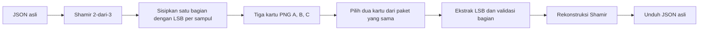

# SetupVault

SetupVault adalah aplikasi web lokal untuk mencadangkan konfigurasi mobil balap simulator. Aplikasi membagi berkas JSON dengan **Shamir Secret Sharing 2-dari-3**, lalu menyisipkan setiap bagian ke dalam kartu sesi PNG dengan **Least Significant Bit (LSB)**. Jika satu kartu hilang atau pemegangnya tidak tersedia, tim dapat memulihkan berkas asli dari dua kartu berbeda dalam paket yang sama.

Proyek ini dikembangkan untuk **CAPSTONE 2026** pada cabang **Kriptografi dan Keamanan Data**. Demo bawaan memakai konfigurasi sintetis **SIM-03 versi 02** dengan skema lintasan **Silverstone Grand Prix Circuit**.



## Fitur

- **Buat Cadangan** menghasilkan tiga PNG yang dapat dibagikan ke pemegang berbeda. Pilih sampul satu per satu atau sekaligus. Pemilihan sekaligus mengisi A–C berdasarkan urutan nama berkas.
- **Pulihkan** mengekstrak dua bagian, memvalidasi paket, lalu mengunduh kembali JSON dengan byte yang sama seperti sumber.
- **Bandingkan sampul dan kartu** menampilkan gambar sebelum dan sesudah penyisipan LSB. **Lihat peta** membuka peta Silverstone dengan 18 nomor tikungan, penanda start/finish, dan pit lane.
- **Evaluasi** menguji semua pasangan kartu yang sah, menyajikan metrik citra dan waktu proses, serta mengekspor hasil ke CSV.

## Instalasi dan cara menjalankan

Siapkan Git, **Python 3.13** dan browser. Perintah berikut memakai PowerShell di Windows. Instalasi dependensi memerlukan internet sekali. Setelah terpasang, demo berjalan offline.

```powershell
git clone https://github.com/splakplutoy/SetupVault.git
cd SetupVault
python -m venv .venv
.\.venv\Scripts\python.exe -m pip install --no-cache-dir -r requirements.txt
.\.venv\Scripts\python.exe -B app.py --open
```

Buka [SetupVault lokal](http://127.0.0.1:8765/) jika tab belum terbuka. Biarkan terminal berjalan selama demo dan tekan **Ctrl+C** untuk menghentikannya. Jika port 8765 sedang digunakan, jalankan perintah terakhir dengan tambahan `--port 8766` dan buka `http://127.0.0.1:8766/`.

Jika perintah `python` pada Windows sudah memiliki semua dependensi, kamu juga bisa klik dua kali [Start-SetupVault.cmd](Start-SetupVault.cmd).

## Demo SIM-03

1. Buka **Buat Cadangan**, klik **Muat demo SIM-03**, lalu buka **Lihat JSON sumber** untuk melihat konfigurasi versi 02.
2. Klik **Buat 3 kartu cadangan**. Unduh kartu **A**, **B**, dan **C**. Buka **Bandingkan sampul dan kartu A** untuk melihat tampilan sebelum dan sesudah penyisipan.
3. Anggap kartu B tidak tersedia. Klik **Pilih kartu A + C**, atau buka **Pulihkan** dan unggah kedua PNG secara manual.
4. Klik **Pulihkan JSON**. Perlihatkan ID paket, pasangan kartu yang lolos validasi, dan SHA-256 hasil. Saat memakai paket terakhir yang dibuat di tab yang sama, aplikasi membandingkan SHA-256 hasil dengan sumber.
5. Klik **Unduh JSON**. Buka **Evaluasi**, jalankan pengujian, lalu klik **Unduh CSV** jika perlu menyimpan metrik.

### Data sendiri

| Input | Ketentuan |
| --- | --- |
| Konfigurasi | Objek JSON UTF-8, maksimal **65.536 byte**. |
| Sampul | Tiga PNG **RGB 8-bit** tanpa transparansi atau animasi. Maksimal **2048 × 2048 piksel** dan **13 MiB** per file. |
| Sampul yang disarankan | **512 × 512 piksel**. Kapasitas mentahnya **98.304 byte** per gambar, cukup untuk satu bagian maksimum dan header 30 byte. |
| Pemulihan | Tepat dua PNG utuh, dengan indeks berbeda dan ID paket yang sama. |

Bagikan satu PNG asli ke setiap pemegang dan simpan terpisah. Pilih mode **berkas** atau **dokumen** saat mengirim lewat aplikasi chat yang mengompresi foto. Pertahankan piksel asli kartu selama penyimpanan dan pengiriman.

## Cara kerja



1. **Bagi rahasia.** Untuk setiap byte, Shamir menempatkan byte sumber sebagai konstanta polinom linear pada medan hingga GF(2⁸). Koefisien acak baru dibuat dengan `secrets.token_bytes`. Titik 1, 2, dan 3 menjadi bagian A, B, dan C.
2. **Sisipkan bagian.** Aplikasi menambahkan header dan menyimpan satu bit per kanal RGB, dari kiri ke kanan dan atas ke bawah. Perubahan nilai setiap kanal dibatasi satu tingkat. Simpan hasil sebagai PNG lossless agar bit yang disisipkan tetap utuh.
3. **Validasi dan pulihkan.** Aplikasi memeriksa penanda, versi, ID paket, indeks, panjang bagian, dan CRC32. Dua titik yang valid dipakai untuk menginterpolasi nilai pada titik nol dan menyusun kembali byte sumber.

### Format paket bagian versi 1

| Field | Ukuran | Isi |
| --- | ---: | --- |
| Penanda | 4 byte | `SVLT` |
| Versi | 1 byte | `1` |
| ID paket | 16 byte | ID acak yang dipakai bersama oleh tiga kartu |
| Indeks | 1 byte | `1`, `2`, atau `3` |
| Panjang bagian | 4 byte | Panjang payload dalam byte |
| CRC32 | 4 byte | Checksum header selain CRC32 dan isi bagian |
| Payload | Sesuai panjang bagian | Bagian yang dibuat dengan Shamir |

Header berukuran **30 byte**. Field bilangan 4 byte disimpan dalam urutan **big-endian**.

### Batas perlindungan

- Satu bagian dari satu paket menjaga kerahasiaan byte konfigurasi. Siapa pun yang menguasai dua kartu yang sah dapat memulihkannya. Metadata paket dan informasi yang terlihat pada kartu dapat diketahui.
- LSB menyamarkan bagian pada gambar. Pola penyisipannya tetap dapat dianalisis dengan steganalisis. Pemrosesan gambar yang mengubah piksel dapat merusak bagian.
- CRC32 mendeteksi kerusakan. Pihak yang sengaja mengganti isi dapat menghitung ulang CRC32. Untuk memeriksa keaslian hasil, bandingkan SHA-256 dengan nilai sumber yang diperoleh dari pihak tepercaya.
- Aplikasi berjalan pada loopback `127.0.0.1`, memproses berkas di memori, dan menyimpan hasil melalui unduhan browser. Purwarupa ini ditujukan untuk demo lokal dan evaluasi dengan data sintetis.

## Pengujian dan hasil

Jalankan dari folder proyek setelah menginstal dependensi.

```powershell
.\.venv\Scripts\python.exe -B -m unittest -v
.\.venv\Scripts\python.exe -B evaluation.py
```

Evaluasi mencoba **10 ukuran JSON dari 100 sampai 65.536 byte**, masing-masing pada **5 pengulangan**. Setiap pengulangan mencoba **A+B, A+C, dan B+C**. Uji citra menghitung **MSE**, **PSNR**, dan **SSIM Gaussian 11 × 11**. Ukuran penyimpanan dibandingkan untuk tiga PNG dan tiga paket bagian tanpa gambar.

| Pemeriksaan | Hasil dengan sampul Silverstone |
| --- | --- |
| Pemulihan | **150 dari 150** menghasilkan byte identik. |
| Pengukuran citra | **150** perbandingan sampul dengan PNG hasil. |
| Penolakan input | **4 dari 4** lulus untuk satu kartu, duplikat, paket berbeda, dan perubahan satu bit bagian. |
| Uji kompresi | Pada sampel uji, konversi PNG ke JPEG kualitas 85 lalu kembali ke PNG membuat paket gagal diekstrak. |

Pada ukuran maksimum **65.536 byte**, pengukuran rata-rata di Windows mencatat **337,75 ms** untuk membuat tiga kartu dan **11,96 ms** untuk pemulihan. PSNR rata-rata **52,90 dB** dan SSIM **0,997703**. Total ukuran rata-rata tiga kartu **526.207 byte**, dengan **196.698 byte** sebagai pembanding tiga paket bagian. Waktu dan hasil kompresi dapat berbeda pada pengujian berikutnya.

[Unduh CSV hasil evaluasi Silverstone](docs/evaluasi-silverstone.csv)

## Struktur proyek

```text
SetupVault/
├── app.py              Server HTTP loopback dan endpoint aplikasi
├── vault.py            Shamir, LSB, format paket, dan validasi
├── silverstone.py      Peta detail dan tiga kartu sesi PNG
├── evaluation.py       Data demo, pengukuran, dan pengujian validasi
├── test_vault.py       Uji regresi pemulihan dan perubahan piksel
├── web/                Antarmuka dan font lokal
├── docs/               Screenshot dan hasil evaluasi
├── requirements.txt    Dependensi Python
└── Start-SetupVault.cmd
```

## Referensi dan aset

- Adi Shamir, [_How to Share a Secret_](https://doi.org/10.1145/359168.359176).
- W3C, [_Portable Network Graphics Specification_](https://www.w3.org/TR/png-3/).
- Zhou Wang, Alan C. Bovik, Hamid R. Sheikh, dan Eero P. Simoncelli, [_Image Quality Assessment From Error Visibility to Structural Similarity_](https://doi.org/10.1109/TIP.2003.819861).
- Peta Silverstone digambar ulang untuk SetupVault. [Panduan sirkuit Formula 1](https://www.formula1.com/en/latest/article/circuit-guide-everything-you-need-to-know-about-silverstone-2026.5Sl0O8g393enBWVIkjRzOr) menjadi referensi layout Grand Prix dan statistik lintasan.
- [Archivo](https://github.com/Omnibus-Type/Archivo) dirilis dengan [SIL Open Font License](web/Archivo-OFL.txt). Lisensi font berlaku untuk aset font.
